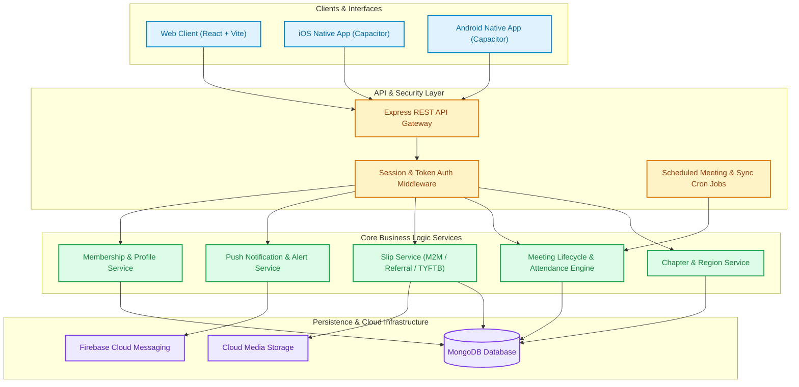

# Sengunthar In Business (SIB)

<div align="center">

  ### Official Digital Platform for Business Networking, Chapter Governance & Member Growth

  [](https://react.dev/)
  [](https://vitejs.dev/)
  [](https://tailwindcss.com/)
  [](https://capacitorjs.com/)
  [](https://senguntharinbusiness.com)
  [](LICENSE)

  <br />

  ### Download & Live Access Channels

  <p align="center">
    <a href="https://senguntharinbusiness.com" target="_blank" rel="noopener noreferrer">
      
    </a>
    &nbsp;&nbsp;
    <a href="https://play.google.com/store/apps/details?id=com.senguntharinbusiness" target="_blank" rel="noopener noreferrer">
      
    </a>
    &nbsp;&nbsp;
    <a href="https://apps.apple.com/app/id6761088485" target="_blank" rel="noopener noreferrer">
      
    </a>
  </p>

</div>

---

## Overview

**Sengunthar In Business (SIB)** is an enterprise-grade organizational management and business networking ecosystem designed for structured community chapters across Tamil Nadu and globally. SIB digitizes chapter administration, referral exchanges, meeting management, attendance tracking, and performance analytics into a single cohesive platform.

Built with modern web and native mobile technologies, SIB empowers members to generate mutual business, track verified transactions, and celebrate milestones while giving leadership full visibility through real-time governance portals.

---

## Platform Availability

| Platform | Channel | Link / Identifier | Status |
| :--- | :--- | :--- | :--- |
| **Web Portal** | Official Web Platform | [senguntharinbusiness.com](https://senguntharinbusiness.com) / [senguntharinbusiness.in](https://senguntharinbusiness.in) | Live |
| **Android App** | Google Play Store | [Install via Google Play](https://play.google.com/store/apps/details?id=com.senguntharinbusiness) (`com.senguntharinbusiness`) | Published |
| **iOS App** | Apple App Store | [Download on App Store](https://apps.apple.com/app/id6761088485) (`com.senguntharinbusiness.app`) | Available |

---

## Key Features & Capabilities

### 1. Multi-Tier Role Governance
- **Regional Admin Portal (`/admin`):** Chapter creation, regional statistics, coordinator role assignments, and system-wide broadcast alerts.
- **President Portal (`/presidentportal`):** Chapter roster governance, core leadership assignments (President, VP, Secretary, Treasurer), meeting creation, and automated WhatsApp/SMS meeting reminder dispatches.
- **Coordinator Portal (`/coordinatorsportal`):** Live check-in meeting attendance marking, slip verification (M2M, Referrals, TYFTB), low attendance alerts, and activity auditing.
- **Member Dashboard (`/dashboard`):** Personal performance metrics, quick activity submission, upcoming schedule preview, and chapter leadership overview.

### 2. High-Velocity Business Slips
- **Member-to-Member (M2M) Slips:** 1-to-1 business interaction recording with client-side image compression, photo proof uploads, and automated chapter auto-filling.
- **Referral Slips:** Intra-chapter and cross-chapter business lead generation with status updates (New, Contacted, In Progress, Closed).
- **Thank You For The Business (TYFTB):** Real-time closed revenue tracking and appreciation slips with instant value aggregations.

### 3. Intelligent Meeting Lifecycle & Attendance
- **Automated Lifecycle Evaluator:** Dynamic transition of meeting status (`upcoming` -> `inprogress` -> `completed`) based on exact Indian Standard Time (IST) schedules.
- **Dual-Date Meeting History:** Clean visual badges displaying both scheduled Meeting Date (amber) and attendance Marked On date (purple) with instant filtering.
- **Attendance Bulk Write:** Atomic, idempotent database resolution keyed on unique member IDs with duplicate collision handling.

### 4. Gamification & Community Engagement
- **Dynamic Leaderboards (`/leaderboard`):** Monthly and all-time rankings calculated from referrals given, business generated, 1-to-1 meetings, and visitors hosted.
- **Wall of Wishes (`/wall-of-wishes`):** Live birthday and wedding anniversary countdowns with celebratory confetti animations and direct member call actions.
- **Performance Badges:** Automatic awarding of badges for Top M2M, Top Referral Contributor, Top TYB Earner, and 100% Attendance.

### 5. Security & Mobile-First Architecture
- **Biometric Authentication:** Face ID, Touch ID, and Fingerprint login on native iOS and Android builds.
- **Session History & Device Detection:** Transparent overview of active logins with OS, browser, IP address, and remote logout capabilities.
- **Role-Scoped Route Guards:** Hardened client-side and server-side authorization ensuring absolute isolation of administrative actions.

---

## System Architecture



---

## Tech Stack

| Domain | Technologies & Libraries |
| :--- | :--- |
| **Frontend Framework** | [React 18](https://react.dev/), [Vite](https://vitejs.dev/) |
| **Mobile Runtime** | [Capacitor 8](https://capacitorjs.com/) (iOS & Android) |
| **Styling & Design System** | [Tailwind CSS](https://tailwindcss.com/), Lucide Icons |
| **State & Data Fetching** | [TanStack React Query](https://tanstack.com/query/latest), Custom Persistent Cache Hooks |
| **Data Visualization** | [Recharts](https://recharts.org/) |
| **Animations & FX** | [GSAP](https://greensock.com/gsap/), `react-confetti-boom`, Canvas Confetti |
| **Native Device Plugins** | `@capacitor-community/contacts`, `@capgo/capacitor-native-biometric`, `@capacitor/share`, `@capacitor-firebase/messaging` |
| **Hosting & Cloud** | [Vercel](https://vercel.com/) (Web), Google Play Store (Android), Apple App Store (iOS) |

---

## Project Structure

```
SIBapp/
├─ public/                        # Static assets and manifest
├─ src/
│  ├─ Admin/                      # Regional Administrator portal & stats
│  ├─ ButtonPages/                # Digital Slips: M2MSlip, ReferalSlip, TYFTB
│  ├─ ChapterPage/                # Chapter-level member lists and overview
│  ├─ Components/                 # Reusable UI widgets & SessionLoadingScreen
│  ├─ Coordinatorsportal/         # Attendance reports & member activity audits
│  ├─ hooks/                      # Authentication, session, and role route guards
│  ├─ MainPage/                   # Core Member Dashboard, Header, and Sidebar
│  ├─ Meetings/                   # Meetings listing and filtering
│  ├─ Members/                    # Member directory and cross-chapter filters
│  ├─ MembersAnalytics/           # Graphical analytics and performance breakdowns
│  ├─ MyActivity/                 # Personal slip submissions & activity stats
│  ├─ NotificationPanel/          # Notification inbox & system alert viewer
│  ├─ PresidentPortal/            # Meeting creation, roster & leadership controls
│  ├─ ProfilePage/                # Member profile, business bio & QR badges
│  ├─ Settings/                   # Password update, session history & security
│  ├─ SigninPage/                 # Phone / username login & biometric gateway
│  ├─ WallOfWishes/               # Celebratory wishes and birthday countdowns
│  ├─ main.jsx                    # Application entry point & router setup
│  └─ index.css                   # Global Tailwind CSS and scrollbar styling
├─ changes made.md                # Multi-platform synchronization registry
├─ vite.config.js                 # Vite bundler configuration
└─ package.json                   # Project scripts and dependencies
```

---

## Multi-Platform Synchronization

This repository operates in continuous alignment with its companion mobile workspaces:
- **Web App (`main`):** Production web deployment hosted on Vercel.
- **iOS App (`feat/ios-build`):** Native iOS project targeting App Store & TestFlight via Codemagic.
- **Android App (`SIB_app_android`):** Native Android project targeting Google Play Store.

All features, bug fixes, and data schema migrations are logged and tracked in [changes made.md](changes%20made.md).

---

## Authors & Maintainers

- **Lead Developer & Maintainer:** [Yonesh Murugan](https://github.com/yoneshmurugan)
- **Organization:** Sengunthar In Business (SIB)

---

## License

This project is licensed under the **MIT License** - see the [LICENSE](LICENSE) file for complete details.
